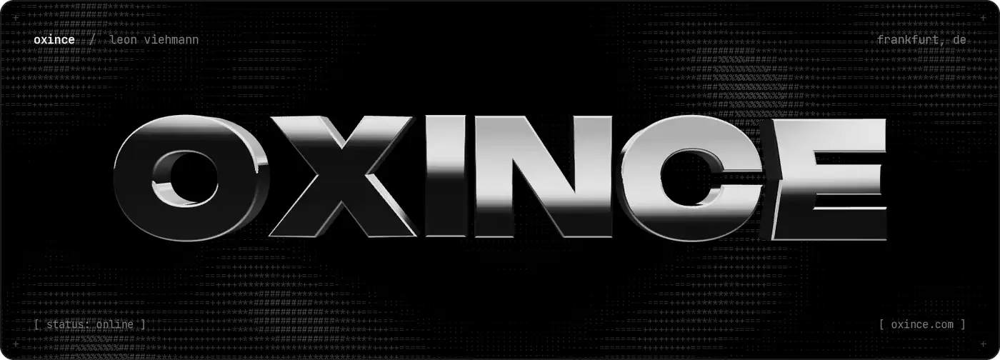

<a href="https://oxince.com"><picture><source media="(prefers-color-scheme: dark)" srcset="assets/dark/hero.webp"><source media="(prefers-color-scheme: light)" srcset="assets/light/hero.webp"></picture></a>

 

<picture><source media="(prefers-color-scheme: dark)" srcset="assets/dark/whoami.svg"><source media="(prefers-color-scheme: light)" srcset="assets/light/whoami.svg"></picture>

 

<picture><source media="(prefers-color-scheme: dark)" srcset="assets/dark/label-work.svg"><source media="(prefers-color-scheme: light)" srcset="assets/light/label-work.svg"></picture>

<picture><source media="(prefers-color-scheme: dark)" srcset="assets/dark/card-wolfy.svg"><source media="(prefers-color-scheme: light)" srcset="assets/light/card-wolfy.svg"></picture> <picture><source media="(prefers-color-scheme: dark)" srcset="assets/dark/card-sycryty.svg"><source media="(prefers-color-scheme: light)" srcset="assets/light/card-sycryty.svg"></picture>
<picture><source media="(prefers-color-scheme: dark)" srcset="assets/dark/card-microo.svg"><source media="(prefers-color-scheme: light)" srcset="assets/light/card-microo.svg"></picture> <a href="https://obfuscate.club"><picture><source media="(prefers-color-scheme: dark)" srcset="assets/dark/card-zerosec.svg"><source media="(prefers-color-scheme: light)" srcset="assets/light/card-zerosec.svg"></picture></a>

 

<picture><source media="(prefers-color-scheme: dark)" srcset="assets/dark/stack.svg"><source media="(prefers-color-scheme: light)" srcset="assets/light/stack.svg"></picture>

 

<a href="mailto:hi@oxince.com"><picture><source media="(prefers-color-scheme: dark)" srcset="assets/dark/signoff.svg"><source media="(prefers-color-scheme: light)" srcset="assets/light/signoff.svg"></picture></a>

<a href="mailto:hi@oxince.com">hi@oxince.com</a> &nbsp;·&nbsp; <a href="https://oxince.com">oxince.com</a> &nbsp;·&nbsp; discord: oxince &nbsp;·&nbsp; open source: <a href="https://github.com/oxince/bahn-rechnung-export">bahn-rechnung-export</a>, <a href="https://github.com/oxince/zerosec-node">zerosec-node</a>

