<a href="https://oxince.com"><picture><source media="(prefers-color-scheme: dark)" srcset="assets/dark/hero.svg"><source media="(prefers-color-scheme: light)" srcset="assets/light/hero.svg"></picture></a>

 

<picture><source media="(prefers-color-scheme: dark)" srcset="assets/dark/whoami.svg"><source media="(prefers-color-scheme: light)" srcset="assets/light/whoami.svg"></picture>

  

<picture><source media="(prefers-color-scheme: dark)" srcset="assets/dark/label-work.svg"><source media="(prefers-color-scheme: light)" srcset="assets/light/label-work.svg"></picture>

<picture><source media="(prefers-color-scheme: dark)" srcset="assets/dark/card-wolfy.svg"><source media="(prefers-color-scheme: light)" srcset="assets/light/card-wolfy.svg"></picture> <picture><source media="(prefers-color-scheme: dark)" srcset="assets/dark/card-sycryty.svg"><source media="(prefers-color-scheme: light)" srcset="assets/light/card-sycryty.svg"></picture>
<picture><source media="(prefers-color-scheme: dark)" srcset="assets/dark/card-microo.svg"><source media="(prefers-color-scheme: light)" srcset="assets/light/card-microo.svg"></picture> <a href="https://obfuscate.club"><picture><source media="(prefers-color-scheme: dark)" srcset="assets/dark/card-zerosec.svg"><source media="(prefers-color-scheme: light)" srcset="assets/light/card-zerosec.svg"></picture></a>

  

<picture><source media="(prefers-color-scheme: dark)" srcset="assets/dark/stack.svg"><source media="(prefers-color-scheme: light)" srcset="assets/light/stack.svg"></picture>

  

<picture><source media="(prefers-color-scheme: dark)" srcset="assets/dark/label-public.svg"><source media="(prefers-color-scheme: light)" srcset="assets/light/label-public.svg"></picture>

<a href="https://github.com/oxince/bahn-rechnung-export"><b>bahn-rechnung-export</b></a> &nbsp;pulls every invoice from your past bahn.de trips and breaks down what you spent 
<a href="https://github.com/oxince/zerosec-node"><b>zerosec-node</b></a> &nbsp;Node client for the ZeroSec obfuscation API

 

<picture><source media="(prefers-color-scheme: dark)" srcset="assets/dark/footer.svg"><source media="(prefers-color-scheme: light)" srcset="assets/light/footer.svg"></picture>

<a href="https://oxince.com"><picture><source media="(prefers-color-scheme: dark)" srcset="assets/dark/btn-web.svg"><source media="(prefers-color-scheme: light)" srcset="assets/light/btn-web.svg"></picture></a>
<a href="mailto:hi@oxince.com"><picture><source media="(prefers-color-scheme: dark)" srcset="assets/dark/btn-mail.svg"><source media="(prefers-color-scheme: light)" srcset="assets/light/btn-mail.svg"></picture></a>
<picture><source media="(prefers-color-scheme: dark)" srcset="assets/dark/btn-discord.svg"><source media="(prefers-color-scheme: light)" srcset="assets/light/btn-discord.svg"></picture>

